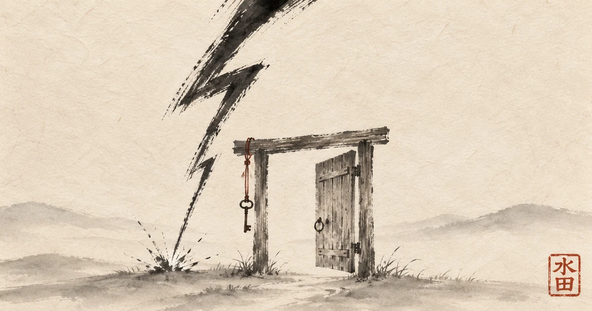

"Not your keys, not your coins."

Another slogan.
Truer than most.

But when I opened my first Lightning channel, I learned a second one that nobody prints on a T-shirt:

Not your liquidity, not your payments.

In [my last essay](/2026/10/22/dont-trust-run-it/) I ended with a question I had just walked into. To receive on Lightning, someone has to open a channel toward you, and they charge for it. Is that a new intermediary, or a free market doing its job?

I have lived with that question for two weeks. This is where I landed.

---

## The Price of Being Paid

The first channel felt like a small victory. My node, my coins, a channel open to the network. I could pay anyone.

Then I tried to receive.

Nothing.

A channel is a pipe with a balance on each side. Everything I had put in sat on my side. To receive, there must be coins on the other side, pointing toward me, and those coins belong to someone else.

So someone else has to lock their bitcoin in a channel aimed at me. And they ask for a fee.

My first reaction was irritation. We built a peer-to-peer money precisely to stop paying rent to middlemen. And here I was, reaching for my wallet to pay rent again.

---

## Liquidity Is Someone Else's Time

Then I looked at what I was actually paying for.

When someone opens a channel toward me, their bitcoin stops being theirs to use. For weeks or months it sits in a pipe that exists only so that I can be paid. They cannot spend it, lend it, or move it somewhere more profitable.

The Austrian economists had a name for what they give up. Böhm-Bawerk and Mises called it time preference: a good today is worth more than the same good tomorrow. Anyone who gives up the present use of their capital asks something in return for waiting.

That is not a toll.
It is interest.

**The inbound liquidity fee is the market price of someone else's patience.**

Nobody forces them to offer it.
Nobody forces me to buy it.
Nobody sets the price but the two of us.

And when liquidity is scarce, the price rises, which invites more people to lock their coins and provide it. The price is doing exactly what prices are for.

---

## A Landlord You Can Leave

The word *rent* still bothers people. It sounds like dependency.

So compare it with a bank.

A bank holds your money. It sets the terms, changes them when it likes, and can freeze, report or close your account. Leaving means asking for your own money back and waiting until they agree.

The liquidity provider holds nothing of mine. My coins stay mine. The rules of the channel are enforced by Bitcoin, not by anyone's goodwill. If the other side misbehaves, I close the channel and the protocol returns my balance. If their price is too high, I buy from someone else, or open channels with people who want to send me money anyway.

**An intermediary you can leave is not a gatekeeper.**

The difference between a landlord and a jailer is the door.

---

## Where Renting Becomes Surrender

There is one kind of renting I will not defend.

Many Lightning wallets solve the liquidity problem by not giving you a channel at all. You get a balance in their app. They hold the coins. Everything just works.

That is not renting liquidity.
That is renting your keys.

It is the same product I wrote about last time, the one every intermediary in history has sold: *we'll handle the hard part*. A bank with a lightning bolt on the logo.

You can leave a liquidity provider and take your coins with you. You can only leave a custodian with their permission.

Custodial wallets have their place. They are a gentle first step, fine for a few sats and a first payment. But you should know which one you are using, because the app looks the same either way.

Rent the pipe.
Never rent the keys.

---

## The Part I Haven't Solved

I won't pretend the market is finished.

Markets can concentrate. If a handful of large providers end up selling most of the inbound liquidity, the door stays open in theory, but the hallway gets narrow. Large nodes also see more of the payments that flow through them, and that is a quiet cost in privacy. And for someone who only wants to receive a few thousand sats, leasing a channel is still absurdly complicated.

I don't think the answer is a regulator or a "fair price" decided by committee. Prices set by committee are how we got here in the first place. The answer is more competition and better tools: channels that resize without closing, wallets that hide the complexity without hiding the custody.

Whether the tools arrive before convenience wins is an open question. So is a deeper one: what does it actually take for a payment to need nobody's permission?

That question deserves its own essay.

---

## The Tenant With the Keys

"Not your keys, not your coins" was a lesson about custody.

Lightning adds a quieter one. Speed has a running cost. Somewhere, someone is waiting, with their coins locked up, so that you can be paid in a second.

I am happy to pay for that.

Not because it is cheap.
Because it is honest: visible, negotiable, and mine to walk away from.

I rent the lightning.
I don't rent the ground it strikes.

**Rent the lightning. Keep the keys.**
